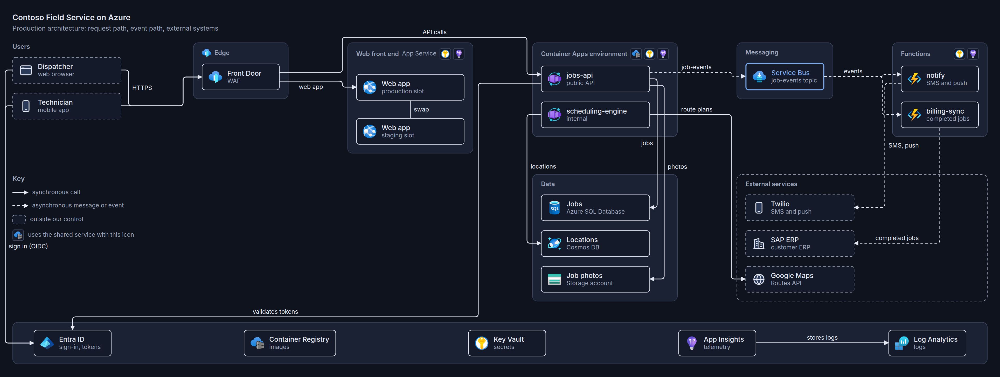

# graphally

An agent skill for professional diagrams. The agent writes a diagram as a small web page:
HTML for what exists and what contains what, CSS (mostly Tailwind-style utility classes)
for where it goes, and a JSON list for what connects to what. graphally lays the page out
in a browser, routes the connections around the boxes, places the labels, applies the
theme, and writes an SVG. Nobody writes a coordinate.

It draws architecture (with Azure and AWS icons), networks, hierarchies, BPMN processes,
flowcharts, sequence diagrams, Gantt plans and roadmaps, phase and role charts and any
other figure a grid can hold, and drafts diagrams of Terraform repositories from the code.

> **Licence.** graphally is open source under the [Apache License 2.0](LICENSE).
> Copyright © 2026 Kamil Wilczyński ([kwilcz](https://github.com/kwilcz)).

<picture><source media="(prefers-color-scheme: dark)" srcset="samples/architecture/diagram-dark.png"></picture>

Every diagram comes in a light and a dark theme from the same source: `render --themes`
writes both, a page shows the one that matches its reader, and a diagram opened in a
browser follows the system setting.

| Light | Dark |
|---|---|
|  |  |

## Install

The skill is self-contained: one folder with its instructions, scripts and assets. It
needs **Node.js 18 or later** and **Chrome, Chromium or Edge** on the machine where the
agent runs. There is no `npm install` and nothing to clone. The first render downloads
the Azure and AWS icon packs into the skill, which takes a few seconds once.

<picture><source media="(prefers-color-scheme: dark)" srcset="docs/diagrams/install-dark.svg"></picture>

**Claude Code**

```text
/plugin install graphally --marketplace kwilcz/graphally
```

On versions of Claude Code without the one-step form, run
`/plugin marketplace add kwilcz/graphally` and then `/plugin install graphally@graphally`.

**GitHub CLI** (2.90 or later), for Claude Code, GitHub Copilot, Cursor, Codex, Gemini CLI
and the other agents it supports:

```sh
gh skill install kwilcz/graphally graphally --agent claude-code --scope user
```

**skills CLI**

```sh
npx skills add kwilcz/graphally --skill graphally -a claude-code -g
```

**Claude.ai and Claude Desktop**: download `graphally-skill.zip` from the
[latest release](https://github.com/kwilcz/graphally/releases/latest) and upload it under
Settings → Capabilities → Skills.

If no browser is found, the skill says so; `npx playwright install chromium` installs
one, or set `CHROMIUM_PATH` to an existing browser. Without internet access, diagrams
render without vendor icons until `node skills/graphally/scripts/fetch-icons.mjs` is run
once online.

## Use

Ask your agent for a diagram as you would ask a colleague: "draw the architecture of
this service", "diagram the Terraform in ./infra", "a sequence diagram of the checkout".
The agent writes the source, renders it, fixes anything reported, and looks at a preview
once.

Every diagram source is also a page: open the `.html` file in a browser (a double-click
will do) and it draws itself. The render adds a three-line header that loads graphally's
viewer from [jsDelivr](https://www.jsdelivr.com), so a colleague without the skill can
read the diagram, edit its text and reload. GitHub shows `.html` files as source, so the
rendered `.svg` stays the file to embed in a README. To work offline or behind a strict
firewall, commit [`skills/graphally/viewer/graphally.js`](skills/graphally/viewer/graphally.js)
next to the diagrams and point the header's `src` at it; `graphallyOptions` (see the top of
[`viewer.js`](skills/graphally/scripts/lib/viewer.js)) points the icons and the typeface at a
mirror.

The source looks like this:

```html
<diagram width=1000 title="Orders platform">
<div class="grid grid-cols-3 items-start justify-between gap-x-20">
  <div class=group><h4>Edge</h4>
    <div class=node id=fd><icon name="front door"></icon>Front Door<small>WAF</small></div></div>
  <div class=group><h4>Application</h4>
    <div class=node id=api><icon name="app service"></icon>Orders API<small>App Service</small></div></div>
  <div class=group><h4>Data</h4>
    <div class=node id=db><icon name=sql></icon>Orders DB<small>Azure SQL</small></div></div>
</div>
<script type="application/json">
[ ["fd", "api", "HTTPS"], ["api", "db", "writes"] ]
</script>
</diagram>
```

The page uses whatever CSS lays it out best: utility classes with Tailwind's names
(`grid grid-cols-3 gap-x-20`), building blocks that look like graphally (`node`, `group`,
`band`, `key`), shapes (`shape="cylinder"`, `shape="gateway exclusive"`), and two helpers for
what CSS cannot do, dates to grid columns and messages to rows. A short drawing script adds
marks that have no box, such as a gate on a boundary. The whole format is in
[`skills/graphally/references/format.md`](skills/graphally/references/format.md), with a page
per kind of diagram beside it.

The skill's scripts can also be run directly:

```sh
node skills/graphally/scripts/graphally.mjs render diagram.html --png    # SVG and a preview PNG
node skills/graphally/scripts/graphally.mjs render diagram.html --png2x  # a sharp PNG to publish
node skills/graphally/scripts/graphally.mjs render diagram.html --themes  # also diagram-dark.svg, the dark theme
node skills/graphally/scripts/graphally.mjs render diagram.html --recompute  # lay out afresh, ignoring the previous SVG
node skills/graphally/scripts/edit.mjs diagram.html --move db 0,20 --connect api cache "reads"  # patch moves and connections
node skills/graphally/scripts/tf2graphally.mjs ./infra --out diagram.html  # a Terraform configuration, drafted
node skills/graphally/scripts/fetch-icons.mjs                            # download or refresh the icon packs
```

**Source and output.** The `.html` source is the diagram; the SVG next to it is compiled
output. Edit the source and render again: the render reads the previous SVG's layout, so
what you did not change stays where it was. Corrections made by hand live in the
source (`nudge="0,24"` on an element, `"out": "bottom"` on a connection), so they survive
later edits, and a render that loses one says so. To commit the SVGs for your docs but keep
them out of pull-request diffs, mark them as generated in `.gitattributes`:

```text
*.svg linguist-generated=true
```

Colours are CSS tokens in `skills/graphally/assets/theme.css`, with a light and a dark
set, so a brand theme only redefines them.

## Samples

Each sample folder holds the brief an agent was given, the source it wrote
(`diagram.html`), and the result (`diagram.svg`).

| Sample | Brief |
|---|---|
| [Architecture](#architecture) | [Azure field-service platform, 23 components](samples/architecture/brief.md) |
| [AWS](#aws) | [serverless photo sharing on AWS](samples/aws/brief.md) |
| [Network](#network) | [hub and two spokes with private endpoints](samples/network/brief.md) |
| [Terraform](#terraform-repository) | [a Terraform repository, plus its users](samples/terraform/brief.md) |
| [Process](#process-bpmn) | [expense approval across four lanes](samples/process/brief.md) |
| [Flowchart](#flowchart) | [release pipeline with approvals and rollback](samples/flowchart/brief.md) |
| [Sequence](#sequence) | [checkout payment with 3-D Secure](samples/sequence/brief.md) |
| [Hierarchy](#hierarchy) | [management groups and subscriptions](samples/hierarchy/brief.md) |
| [Plan](#plan-gantt) | [six-month migration plan](samples/plan/brief.md) |
| [Icon diagram](#icon-diagram) | [Microsoft Entra application proxy](samples/icons/brief.md) |
| [Phase and role chart](#phase-and-role-chart) | [who does what, phase by phase, in a move to AKS](samples/page/brief.md) |

### Architecture

The diagram at the top of this page. Tiers as columns, a platform band, async traffic
dashed, external systems dashed. Shared services (Key Vault, App Insights, the registry)
appear as badges in the headers of the tiers that use them, instead of wires.
[Brief](samples/architecture/brief.md) · [source](samples/architecture/diagram.html) ·
[SVG](samples/architecture/diagram.svg)

### AWS

<picture><source media="(prefers-color-scheme: dark)" srcset="samples/aws/diagram-dark.png"></picture>

The same kind of diagram with the AWS pack: CloudFront and WAF at the edge, Lambda
functions behind API Gateway, and the asynchronous path from S3 through SQS and SNS
drawn dashed. CloudWatch and Secrets Manager are badges on the two function groups.
[Brief](samples/aws/brief.md) · [source](samples/aws/diagram.html) ·
[SVG](samples/aws/diagram.svg)

### Network

<picture><source media="(prefers-color-scheme: dark)" srcset="samples/network/diagram-dark.png"></picture>

VNets, subnets with their address ranges, resources inside their subnets, peering, a
default route to the firewall, private endpoints to the PaaS services below.
[Brief](samples/network/brief.md) · [source](samples/network/diagram.html) ·
[SVG](samples/network/diagram.svg)

### Terraform repository

<picture><source media="(prefers-color-scheme: dark)" srcset="samples/terraform/diagram-dark.png"></picture>

`tf2graphally` read the configuration in [`repo/`](samples/terraform/repo) and wrote
[`draft.html`](samples/terraform/draft.html) ([rendered](samples/terraform/draft.svg)),
without the agent reading the HCL. The agent then added what Terraform cannot know, the
users and the VPN from head office, and rearranged the services.
[Brief](samples/terraform/brief.md) · [source](samples/terraform/diagram.html) ·
[SVG](samples/terraform/diagram.svg)

### Process (BPMN)

<picture><source media="(prefers-color-scheme: dark)" srcset="samples/process/diagram-dark.png"></picture>

Four lanes, one column per step in the order the flow runs, gateways with labelled
branches, a three-day timer on the review task, notices between lanes dashed.
[Brief](samples/process/brief.md) · [source](samples/process/diagram.html) ·
[SVG](samples/process/diagram.svg)

### Flowchart

The happy path runs along the middle; every failure branches up, and the expired
approval drops below.

<picture><source media="(prefers-color-scheme: dark)" srcset="samples/flowchart/diagram-dark.png"></picture>

[Brief](samples/flowchart/brief.md) · [source](samples/flowchart/diagram.html) ·
[SVG](samples/flowchart/diagram.svg)

### Sequence

<picture><source media="(prefers-color-scheme: dark)" srcset="samples/sequence/diagram-dark.png"></picture>

Numbered steps, activation bars, an `alt` for 3-D Secure, a `par` with a polling `loop`.
[Brief](samples/sequence/brief.md) · [source](samples/sequence/diagram.html) ·
[SVG](samples/sequence/diagram.svg)

### Hierarchy

One column per leaf and one row per level: each parent spans its children, and one
connection per parent draws its bus.

<picture><source media="(prefers-color-scheme: dark)" srcset="samples/hierarchy/diagram-dark.png"></picture>

[Brief](samples/hierarchy/brief.md) · [source](samples/hierarchy/diagram.html) ·
[SVG](samples/hierarchy/diagram.svg)

### Plan (Gantt)

A task table beside the chart, a critical path, a blocked approval holding back the
pilot, parallel work, and only the dependencies that tell the story.

<picture><source media="(prefers-color-scheme: dark)" srcset="samples/plan/diagram-dark.png"></picture>

[Brief](samples/plan/brief.md) · [source](samples/plan/diagram.html) ·
[SVG](samples/plan/diagram.svg)

### Icon diagram

Figures: an icon over its name, in plain groups.

<picture><source media="(prefers-color-scheme: dark)" srcset="samples/icons/diagram-dark.png"></picture>

[Brief](samples/icons/brief.md) · [source](samples/icons/diagram.html) ·
[SVG](samples/icons/diagram.svg)

### Phase and role chart

<picture><source media="(prefers-color-scheme: dark)" srcset="samples/page/diagram-dark.png"></picture>

[Brief](samples/page/brief.md) · [source](samples/page/diagram.html) ·
[SVG](samples/page/diagram.svg)

## Repository

| Path | Contains |
|---|---|
| [`skills/graphally/`](skills/graphally) | the skill: `SKILL.md`, `references/`, `scripts/` (the engine), `assets/` (theme, icons) |
| [`.claude-plugin/`](.claude-plugin) | the Claude Code plugin and marketplace manifests |
| [`samples/`](samples) | briefs and the diagrams drawn from them |
| [`docs/design.md`](docs/design.md) | how graphally works, illustrated with diagrams it drew ([sources](docs/diagrams)) |
| [`tools/`](tools) | maintenance scripts, such as rebuilding the icon pack |

## Licence

graphally is licensed under the [Apache License, Version 2.0](LICENSE): you may use,
copy, modify and redistribute it, commercially included, provided you keep the copyright
and licence notices ([NOTICE](NOTICE)). The diagrams you make with it are yours.

Cloud icons are not part of graphally and not covered by this licence. The skill
downloads Microsoft's Azure icons from the draw.io project and the AWS Architecture Icons
from the npm registry; they remain subject to Microsoft's and Amazon's terms.
