# graphally

An agent skill for professional diagrams. The agent writes a diagram as a small web page:
HTML for what exists and what contains what, CSS (mostly Tailwind-style utility classes)
for where it goes, and a JSON list for what connects to what. graphally lays the page out
in a browser, routes the connections around the boxes, places the labels, applies the
theme, and writes an SVG. Nobody writes a coordinate.

It draws architecture (with Azure and AWS icons), networks, hierarchies, BPMN processes,
flowcharts, sequence diagrams, Gantt plans and roadmaps, phase and role charts, figures
for proposals and solution designs, and any other figure a grid can hold, and drafts
diagrams of Terraform repositories from the code.

> **Licence.** graphally is open source under the [Apache License 2.0](LICENSE).
> Copyright © 2026 Kamil Wilczyński ([kwilcz](https://github.com/kwilcz)).

<picture><source media="(prefers-color-scheme: dark)" srcset="samples/azure-platform/diagram-dark.png">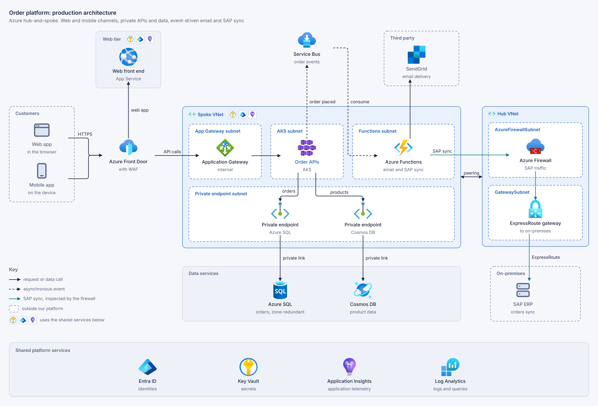</picture>

Every figure above was drawn by an agent from a brief; the
[showcase](samples/README.md) has each one with its brief and the source the agent wrote.

| | |
|---|---|
| <picture><source media="(prefers-color-scheme: dark)" srcset="samples/cost-rise/diagram-dark.png">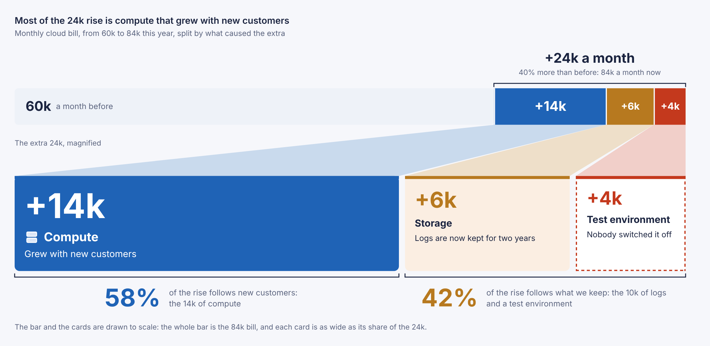</picture> | <picture><source media="(prefers-color-scheme: dark)" srcset="samples/data-lineage/diagram-dark.png">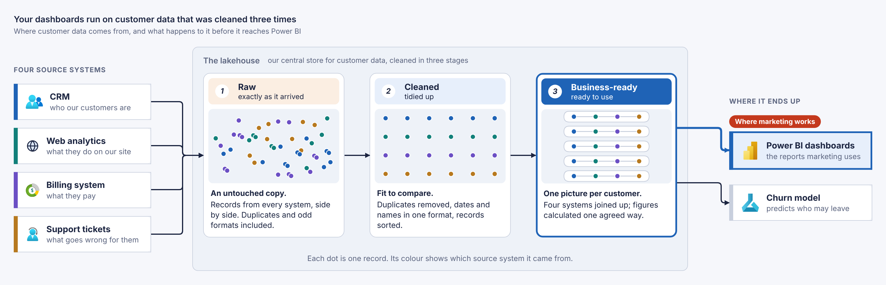</picture> |
| **Why the cloud bill grew.** The 24k rise, magnified to scale. | **Where customer data comes from.** The same records, tidied stage by stage. |
| <picture><source media="(prefers-color-scheme: dark)" srcset="samples/migration-waves/diagram-dark.png">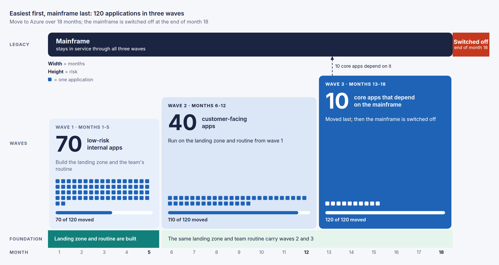</picture> | <picture><source media="(prefers-color-scheme: dark)" srcset="samples/release-gates/diagram-dark.png">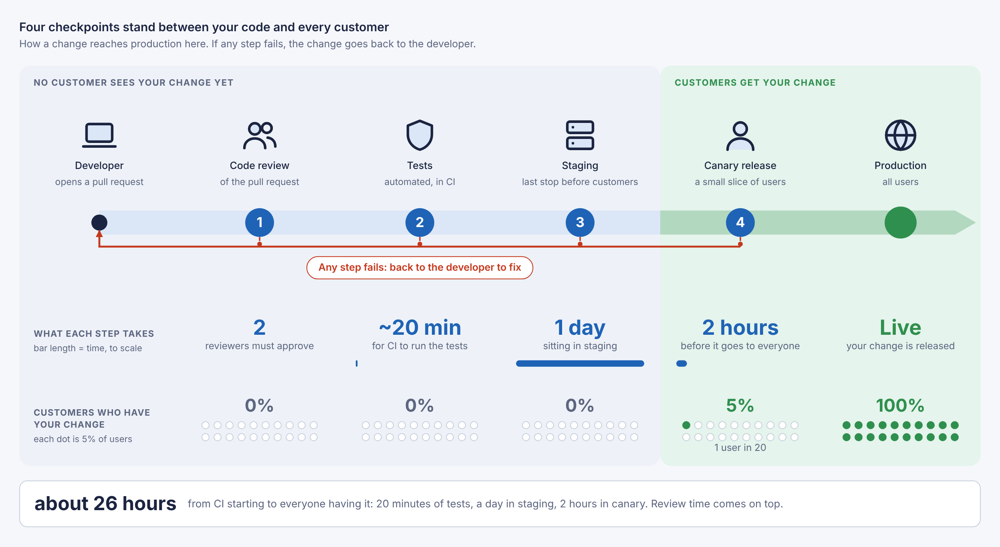</picture> |
| **Three waves to Azure.** Width for months, height for risk, a square per application. | **How a change reaches production.** Waits to scale; the users who have the change, as dots. |
| <picture><source media="(prefers-color-scheme: dark)" srcset="samples/responsibility-split/diagram-dark.png">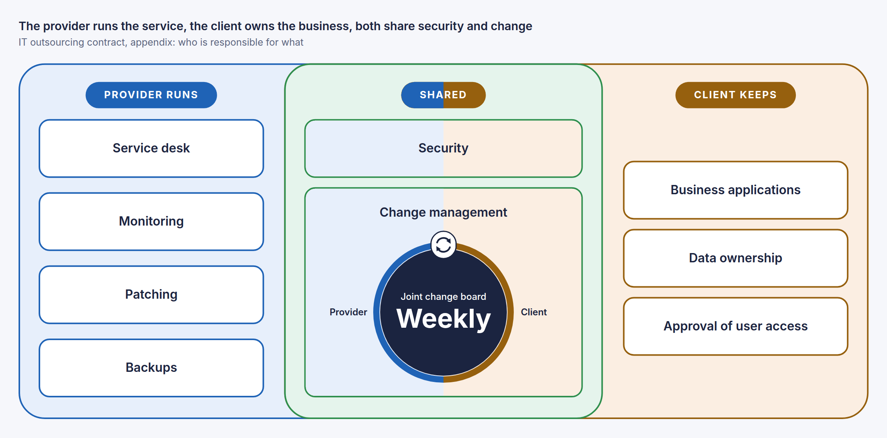</picture> | <picture><source media="(prefers-color-scheme: dark)" srcset="samples/data-lake/diagram-dark.png">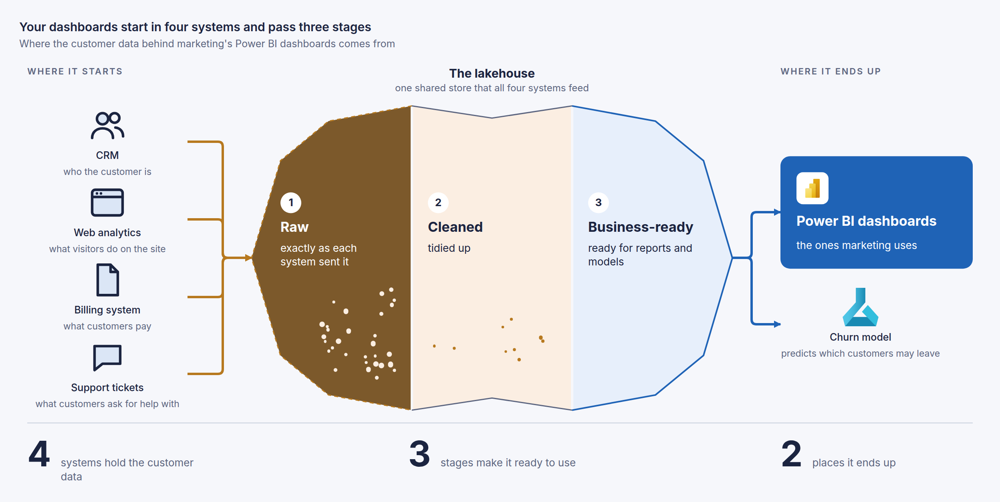</picture> |
| **Who is responsible for what.** Two territories that overlap at a weekly round table. | **The same brief, another design.** The lakehouse as water that clears. |
| <picture><source media="(prefers-color-scheme: dark)" srcset="samples/aws-telemetry/diagram-dark.png">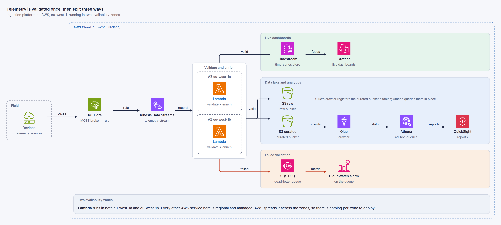</picture> | <picture><source media="(prefers-color-scheme: dark)" srcset="samples/landing-zone/diagram-dark.png">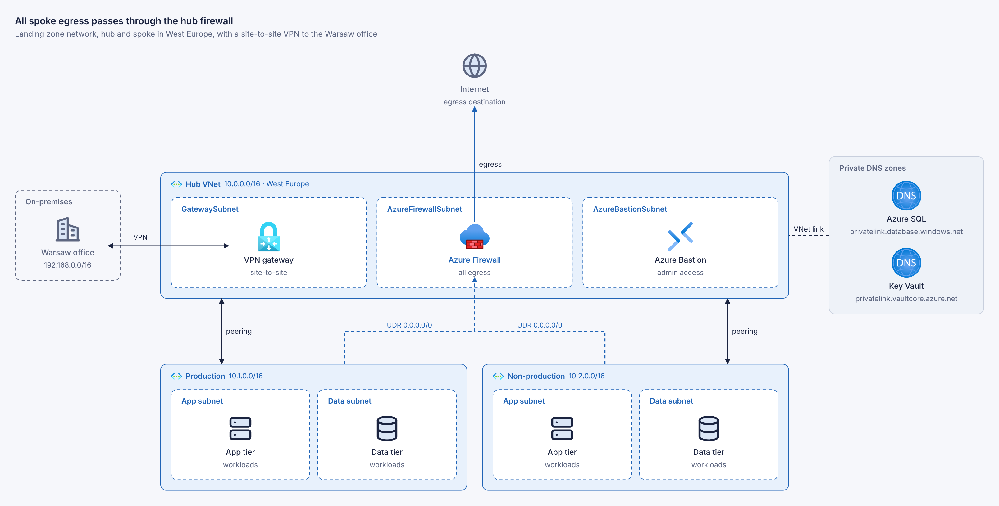</picture> |
| **Telemetry ingestion on AWS.** Validated once, then split three ways. | **Landing zone network.** Every spoke's egress through the hub firewall. |
| <picture><source media="(prefers-color-scheme: dark)" srcset="samples/claims-process/diagram-dark.png">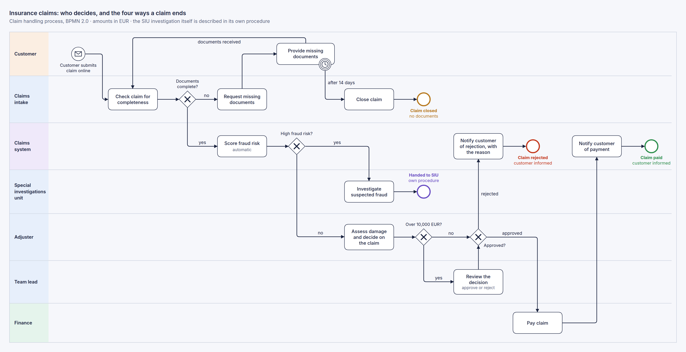</picture> | <picture><source media="(prefers-color-scheme: dark)" srcset="samples/order-journey/diagram-dark.png">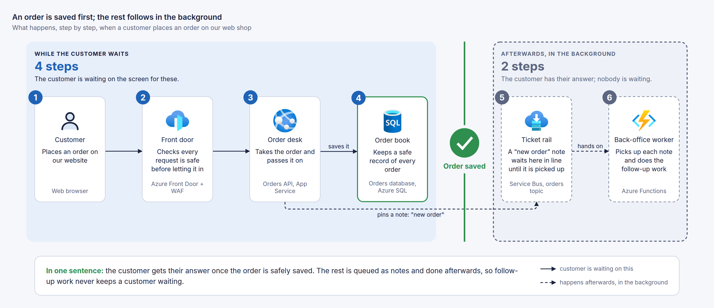</picture> |
| **Insurance claim process.** BPMN; the four ways a claim ends are the only colour. | **The orders diagram, for business.** An engineer's topology, redrawn around one wall. |

Every diagram comes in a light and a dark theme from the same source: `render --themes`
writes both, a page shows the one that matches its reader, and a diagram opened in a
browser follows the system setting.

| Light | Dark |
|---|---|
|  | 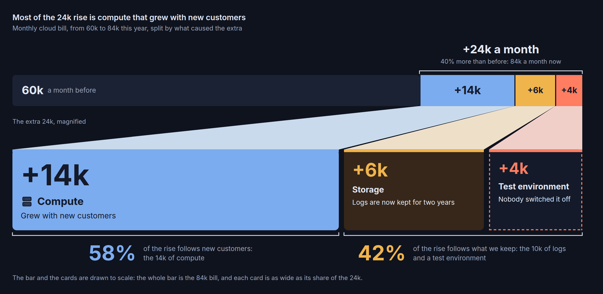 |

## Install

The skill is self-contained: one folder with its instructions, scripts and assets. It
needs **Node.js 18 or later** and **Chrome, Chromium or Edge** on the machine where the
agent runs. There is no `npm install` and nothing to clone. The first render downloads
the Azure and AWS icon packs into the skill, which takes a few seconds once.

<picture><source media="(prefers-color-scheme: dark)" srcset="docs/diagrams/install-dark.svg"></picture>

**Claude Code**

```text
/plugin install graphally --marketplace kwilcz/graphally
```

On versions of Claude Code without the one-step form, run
`/plugin marketplace add kwilcz/graphally` and then `/plugin install graphally@graphally`.

**GitHub CLI** (2.90 or later), for Claude Code, GitHub Copilot, Cursor, Codex, Gemini CLI
and the other agents it supports:

```sh
gh skill install kwilcz/graphally graphally --scope user
```

**GitHub Copilot CLI**

```sh
copilot plugin marketplace add kwilcz/graphally
copilot plugin install graphally@graphally
```

**skills CLI**

```sh
npx skills add kwilcz/graphally --skill graphally -g
```

**Claude.ai and Claude Desktop**: download `graphally-skill.zip` from the
[latest release](https://github.com/kwilcz/graphally/releases/latest) and upload it under
Settings → Capabilities → Skills.

If no browser is found, the skill says so; `npx playwright install chromium` installs
one, or set `CHROMIUM_PATH` to an existing browser. Without internet access, diagrams
render without vendor icons until `node skills/graphally/scripts/fetch-icons.mjs` is run
once online.

## Use

Ask your agent for a diagram as you would ask a colleague: "draw the architecture of
this service", "diagram the Terraform in ./infra", "a sequence diagram of the checkout".
The agent writes the source, renders it, fixes anything reported, and looks at a preview
once.

Every diagram source is also a page: open the `.html` file in a browser (a double-click
will do) and it draws itself. The render adds a three-line header that loads graphally's
viewer from [jsDelivr](https://www.jsdelivr.com), so a colleague without the skill can
read the diagram, edit its text and reload. GitHub shows `.html` files as source, so the
rendered `.svg` stays the file to embed in a README. To work offline or behind a strict
firewall, commit [`skills/graphally/viewer/graphally.js`](skills/graphally/viewer/graphally.js)
next to the diagrams and point the header's `src` at it; `graphallyOptions` (see the top of
[`viewer.js`](skills/graphally/scripts/lib/viewer.js)) points the icons and the typeface at a
mirror.

The source looks like this:

```html
<diagram width=1000 title="Orders platform">
<div class="grid grid-cols-3 items-start justify-between gap-x-20">
  <div class=group><h4>Edge</h4>
    <div class=node id=fd><icon name="front door"></icon>Front Door<small>WAF</small></div></div>
  <div class=group><h4>Application</h4>
    <div class=node id=api><icon name="app service"></icon>Orders API<small>App Service</small></div></div>
  <div class=group><h4>Data</h4>
    <div class=node id=db><icon name=sql></icon>Orders DB<small>Azure SQL</small></div></div>
</div>
<script type="application/json">
[ ["fd", "api", "HTTPS"], ["api", "db", "writes"] ]
</script>
</diagram>
```

The page uses whatever CSS lays it out best: utility classes with Tailwind's names
(`grid grid-cols-3 gap-x-20`), building blocks that look like graphally (`node`, `group`,
`band`, `key`), shapes (`shape="cylinder"`, `shape="gateway exclusive"`), and two helpers for
what CSS cannot do, dates to grid columns and messages to rows. A short drawing script adds
marks that have no box, such as a gate on a boundary. The whole format is in
[`skills/graphally/references/format.md`](skills/graphally/references/format.md), with a page
per kind of diagram beside it.

The skill's scripts can also be run directly:

```sh
node skills/graphally/scripts/graphally.mjs render diagram.html --png    # SVG and a preview PNG
node skills/graphally/scripts/graphally.mjs render diagram.html --png2x  # a sharp PNG to publish
node skills/graphally/scripts/graphally.mjs render diagram.html --themes  # also diagram-dark.svg, the dark theme
node skills/graphally/scripts/graphally.mjs render diagram.html --recompute  # lay out afresh, ignoring the previous SVG
node skills/graphally/scripts/graphally.mjs render a.html b.html c.html  # several files in one browser, in parallel
node skills/graphally/scripts/edit.mjs diagram.html --move db 0,20 --connect api cache "reads"  # patch moves and connections
node skills/graphally/scripts/tf2graphally.mjs ./infra --out diagram.html  # a Terraform configuration, drafted
node skills/graphally/scripts/fetch-icons.mjs                            # download or refresh the icon packs
```

**Source and output.** The `.html` source is the diagram; the SVG next to it is compiled
output. Edit the source and render again: the render reads the previous SVG's layout, so
what you did not change stays where it was. Corrections made by hand live in the
source (`nudge="0,24"` on an element, `"out": "bottom"` on a connection), so they survive
later edits, and a render that loses one says so. To commit the SVGs for your docs but keep
them out of pull-request diffs, mark them as generated in `.gitattributes`:

```text
*.svg linguist-generated=true
```

Colours are CSS tokens in `skills/graphally/assets/theme.css`, with a light and a dark
set, so a brand theme only redefines them.

## Samples

[The showcase](samples/README.md) has every sample, in your theme, with the brief the agent
was given and the source it wrote.

- **Basic**, the everyday technical diagrams: [architecture](samples/README.md#architecture),
  [AWS](samples/README.md#aws), [network](samples/README.md#network),
  [Terraform repository](samples/README.md#terraform-repository),
  [BPMN process](samples/README.md#process-bpmn), [flowchart](samples/README.md#flowchart),
  [sequence](samples/README.md#sequence), [hierarchy](samples/README.md#hierarchy),
  [icon diagram](samples/README.md#icon-diagram).
- **Advanced**, figures that go past boxes and lines, most of them for proposals and
  solution designs: [Gantt plan](samples/README.md#plan-gantt),
  [phase and role chart](samples/README.md#phase-and-role-chart),
  [governance pyramid](samples/README.md#governance-pyramid),
  [scope target](samples/README.md#scope-target),
  [solution stack](samples/README.md#solution-stack).
- **Designed for the point**, from briefs that name no kind of diagram:
  [why the cloud bill grew](samples/README.md#why-the-cloud-bill-grew),
  [where customer data comes from](samples/README.md#where-customer-data-comes-from) and
  [the same brief, another design](samples/README.md#the-same-brief-another-design),
  [three waves to Azure](samples/README.md#three-waves-to-azure),
  [how a change reaches production](samples/README.md#how-a-change-reaches-production),
  [who is responsible for what](samples/README.md#who-is-responsible-for-what),
  [the orders diagram, for business](samples/README.md#the-orders-diagram-for-business);
  and, in depth, [an Azure platform](samples/README.md#order-platform-on-azure),
  [AWS telemetry ingestion](samples/README.md#telemetry-ingestion-on-aws),
  [a landing zone network](samples/README.md#landing-zone-network) and
  [a BPMN claim process](samples/README.md#insurance-claim-process).

## Releases

Every pull request merged into `main` is a release, and its label chooses which: `build` (the
default, also with no label), `minor` or `major`. At the merge, the release workflow works out
the next version from the last tag, commits it to `main`, tags it and publishes the release
with the skill attached; on the pull request, its summary says which version the merge will
make. The version lives in `SKILL.md` and both plugin manifests: `node tools/version.mjs`
prints it, and `--check` checks that they agree. Diagrams load the viewer of their major
version (`…/graphally@2/…`), which follows its latest release.

## Repository

| Path | Contains |
|---|---|
| [`skills/graphally/`](skills/graphally) | the skill: `SKILL.md`, `references/`, `scripts/` (the engine), `assets/` (theme, icons) |
| [`.claude-plugin/`](.claude-plugin) | the Claude Code plugin and marketplace manifests |
| [`samples/`](samples) | briefs and the diagrams drawn from them; [the showcase](samples/README.md) |
| [`docs/design.md`](docs/design.md) | how graphally works, illustrated with diagrams it drew ([sources](docs/diagrams)) |
| [`tools/`](tools) | maintenance scripts, such as rebuilding the icon pack |

## Licence

graphally is licensed under the [Apache License, Version 2.0](LICENSE): you may use,
copy, modify and redistribute it, commercially included, provided you keep the copyright
and licence notices ([NOTICE](NOTICE)). The diagrams you make with it are yours.

Cloud icons are not part of graphally and not covered by this licence. The skill
downloads Microsoft's Azure icons from the draw.io project and the AWS Architecture Icons
from the npm registry; they remain subject to Microsoft's and Amazon's terms.
