# graphally

An agent skill for professional diagrams. The agent writes a short HTML description:
what exists, what contains what, and what talks to what. graphally measures the text,
places and aligns the boxes, routes the edges, places the labels, applies the theme, and
writes an SVG.

It draws architecture (with Azure and AWS icons), network, hierarchy, BPMN process,
flowchart, sequence, plan (Gantt) and icon diagrams, and drafts diagrams of Terraform
repositories from the code. Anything else (phase and role charts, matrices, step cards,
roadmaps) is written as plain HTML and CSS, with a short script for the lines.

> **Licence.** graphally is source-available, not open source. You may install it and let
> your agents use it for any purpose, including paid work, and the diagrams you make are
> yours. You may not copy, modify, redistribute or sell it, or build it into other
> products or systems, without written permission. See [LICENSE](LICENSE).
> Copyright © 2026 Kamil Wilczyński ([kwilcz](https://github.com/kwilcz)).

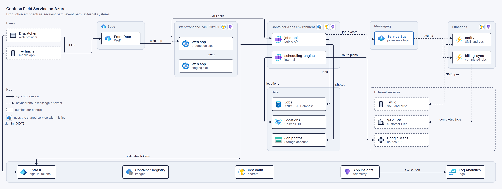

## Install

The skill is self-contained: one folder with its instructions, scripts and assets. It
needs **Node.js 18 or later** and **Chrome, Chromium or Edge** on the machine where the
agent runs. There is no `npm install` and nothing to clone. The first render downloads
the Azure and AWS icon packs into the skill, which takes a few seconds once.


**Claude Code**

```text
/plugin install graphally --marketplace kwilcz/graphally
```

On versions of Claude Code without the one-step form, run
`/plugin marketplace add kwilcz/graphally` and then `/plugin install graphally@graphally`.

**GitHub CLI** (2.90 or later), for Claude Code, GitHub Copilot, Cursor, Codex, Gemini CLI
and the other agents it supports:

```sh
gh skill install kwilcz/graphally graphally --agent claude-code --scope user
```

**skills CLI**

```sh
npx skills add kwilcz/graphally --skill graphally -a claude-code -g
```

**Claude.ai and Claude Desktop**: download `graphally-skill.zip` from the
[latest release](https://github.com/kwilcz/graphally/releases/latest) and upload it under
Settings → Capabilities → Skills.

If no browser is found, the skill says so; `npx playwright install chromium` installs
one, or set `CHROMIUM_PATH` to an existing browser. Without internet access, diagrams
render without vendor icons until `node skills/graphally/scripts/fetch-icons.mjs` is run
once online.

## Use

Ask your agent for a diagram as you would ask a colleague: "draw the architecture of
this service", "diagram the Terraform in ./infra", "a sequence diagram of the checkout".
The agent writes the source, renders it, fixes anything reported, and looks at a preview
once.

The source looks like this:

```html
<diagram title="Orders platform">
<layout>
edge  app
.     data
</layout>
<group id=edge label="Edge"><node id=fd icon="front door">Front Door | WAF</node></group>
<group id=app label="Application"><node id=api icon="app service">Orders API</node></group>
<group id=data label="Data"><node id=db icon=sql>Orders DB | Azure SQL</node></group>
<links>
fd -> api : HTTPS
api -> db : writes
</links>
</diagram>
```

The skill's scripts can also be run directly:

```sh
node skills/graphally/scripts/graphally.mjs render diagram.html --png    # SVG and a preview PNG
node skills/graphally/scripts/graphally.mjs render diagram.html --png2x  # a sharp PNG; --dark for the dark theme
node skills/graphally/scripts/graphally.mjs render diagram.html --recompute  # lay out afresh, ignoring the previous SVG
node skills/graphally/scripts/edit.mjs diagram.html --move db 0,20 --connect api cache "reads"  # patch a page-mode diagram
node skills/graphally/scripts/tf2graphally.mjs ./infra --out diagram.html  # a Terraform configuration, drafted
node skills/graphally/scripts/fetch-icons.mjs                            # download or refresh the icon packs
```

**Source and output.** The `.html` source is the diagram; the SVG next to it is compiled
output. Edit the source and render again: the render reads the previous SVG's layout, so
what you did not change stays where it was. Corrections made by hand are attributes in the
source (`nudge="0,24"` on a node, `out=bottom in=left` on a `<link>`), so they survive
later edits, and a render that loses one says so. To commit the SVGs for your docs but keep
them out of pull-request diffs, mark them as generated in `.gitattributes`:

```text
*.svg linguist-generated=true
```

**Figures in HTML.** `<diagram layout=html>` is a page of HTML and CSS: the browser lays it
out, shapes come from `shape="cylinder"`, `shape="gateway parallel"` and the like, and the
connections are data, a JSON list routed around the boxes:

```html
<script type="application/json">
[ { "from": "api", "to": "db", "label": "writes" }, ["api", "queue", "events"] ]
</script>
```

Colours are CSS tokens in `skills/graphally/assets/theme.css`, so a brand theme only
redefines them. Large diagrams can be split into files with `<include src="parts/app.html">`.

## Samples

Each sample folder holds the brief an agent was given, the source it wrote
(`diagram.html`), and the result (`diagram.svg`).

| Sample | Brief |
|---|---|
| [Architecture](#architecture) | [Azure field-service platform, 23 components](samples/architecture/brief.md) |
| [AWS](#aws) | [serverless photo sharing on AWS](samples/aws/brief.md) |
| [Network](#network) | [hub and two spokes with private endpoints](samples/network/brief.md) |
| [Terraform](#terraform-repository) | [a Terraform repository, plus its users](samples/terraform/brief.md) |
| [Process](#process-bpmn) | [expense approval across four lanes](samples/process/brief.md) |
| [Flowchart](#flowchart) | [release pipeline with approvals and rollback](samples/flowchart/brief.md) |
| [Sequence](#sequence) | [checkout payment with 3-D Secure](samples/sequence/brief.md) |
| [Hierarchy](#hierarchy) | [management groups and subscriptions](samples/hierarchy/brief.md) |
| [Plan](#plan-gantt) | [six-month migration plan](samples/plan/brief.md) |
| [Icon diagram](#icon-diagram) | [Microsoft Entra application proxy](samples/icons/brief.md) |
| [Figure in HTML](#figure-in-html) | [who does what, phase by phase, in a move to AKS](samples/page/brief.md) |

### Architecture

The diagram at the top of this page. Tiers as columns, a platform band, async traffic
dashed, external systems dashed. Shared services (Key Vault, App Insights, the registry)
appear as badges in the headers of the tiers that use them, instead of wires.
[Brief](samples/architecture/brief.md) · [source](samples/architecture/diagram.html) ·
[SVG](samples/architecture/diagram.svg)

### AWS

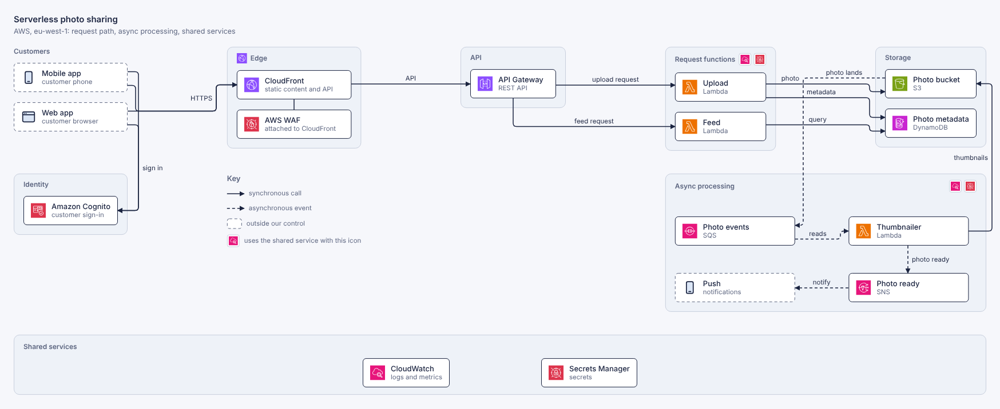

The same kind of diagram with the AWS pack: CloudFront and WAF at the edge, Lambda
functions behind API Gateway, and the asynchronous path from S3 through SQS and SNS
drawn dashed. CloudWatch and Secrets Manager are badges on the two function groups.
[Brief](samples/aws/brief.md) · [source](samples/aws/diagram.html) ·
[SVG](samples/aws/diagram.svg)

### Network

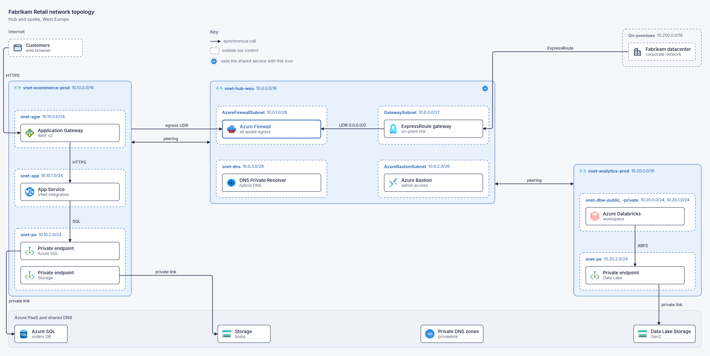

VNets, subnets with their address ranges, resources inside their subnets, peering, a
default route to the firewall, private endpoints to the PaaS services below.
[Brief](samples/network/brief.md) · [source](samples/network/diagram.html) ·
[SVG](samples/network/diagram.svg)

### Terraform repository

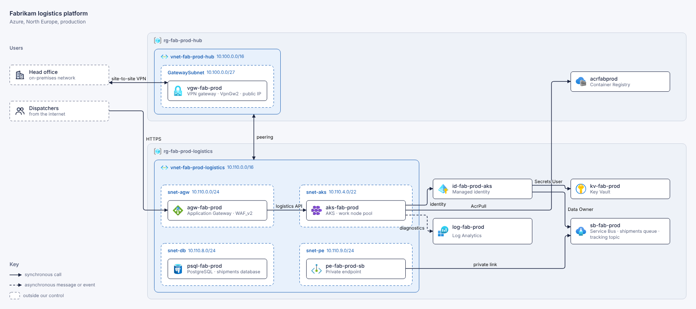

`tf2graphally` read the configuration in [`repo/`](samples/terraform/repo) and wrote
[`draft.html`](samples/terraform/draft.html) ([rendered](samples/terraform/draft.svg)),
without the agent reading the HCL. The agent then added what Terraform cannot know, the
users and the VPN from head office, and rearranged the services.
[Brief](samples/terraform/brief.md) · [source](samples/terraform/diagram.html) ·
[SVG](samples/terraform/diagram.svg)

### Process (BPMN)

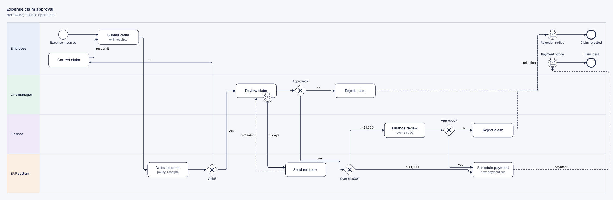

Four lanes, gateways with one branch per corner, a three-day timer on the review task,
message flows between lanes.
[Brief](samples/process/brief.md) · [source](samples/process/diagram.html) ·
[SVG](samples/process/diagram.svg)

### Flowchart

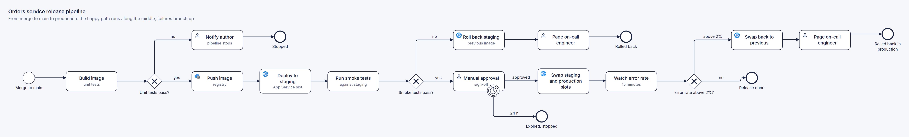

[Brief](samples/flowchart/brief.md) · [source](samples/flowchart/diagram.html) ·
[SVG](samples/flowchart/diagram.svg)

### Sequence

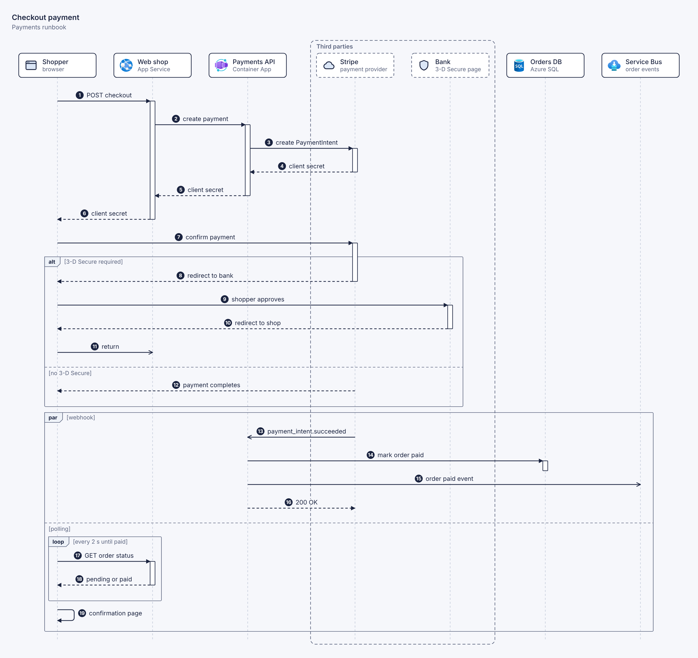

Numbered steps, activation bars, an `alt` for 3-D Secure, a `par` with a polling `loop`.
[Brief](samples/sequence/brief.md) · [source](samples/sequence/diagram.html) ·
[SVG](samples/sequence/diagram.svg)

### Hierarchy

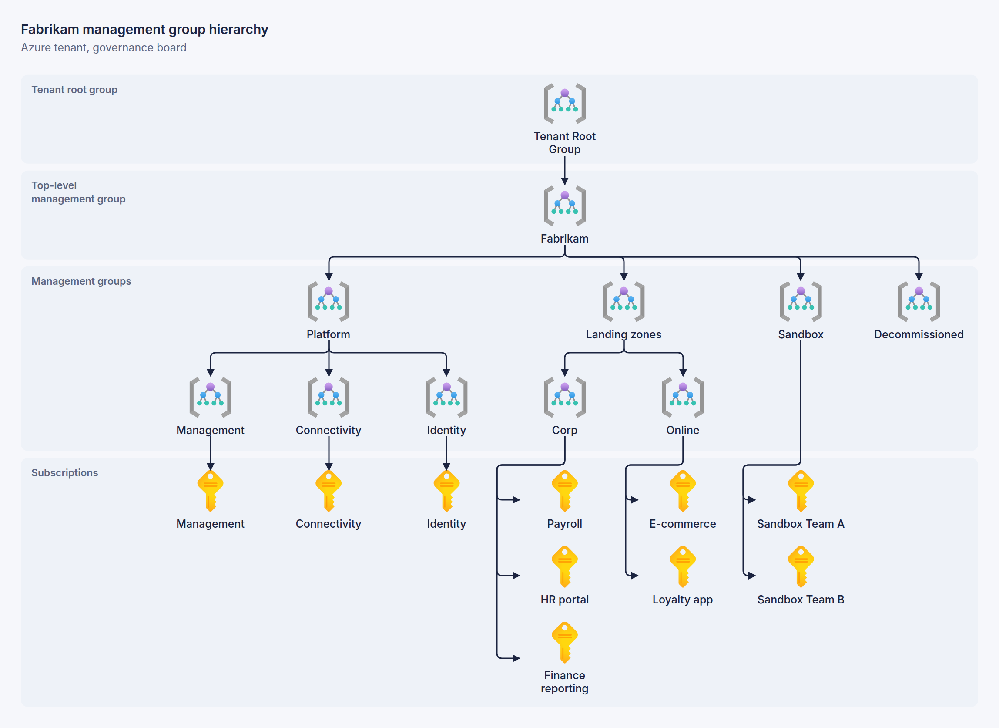

[Brief](samples/hierarchy/brief.md) · [source](samples/hierarchy/diagram.html) ·
[SVG](samples/hierarchy/diagram.svg)

### Plan (Gantt)

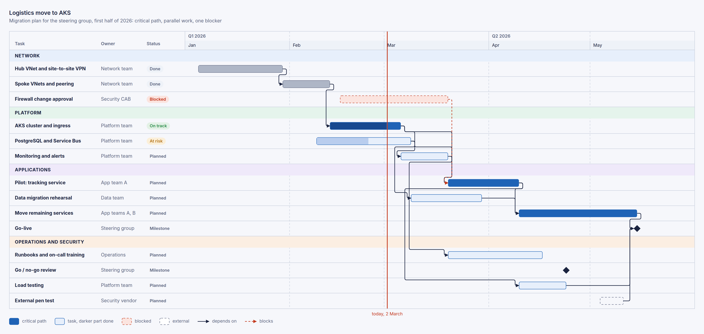

[Brief](samples/plan/brief.md) · [source](samples/plan/diagram.html) ·
[SVG](samples/plan/diagram.svg)

### Icon diagram

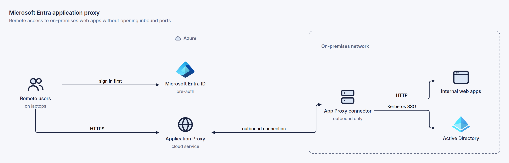

[Brief](samples/icons/brief.md) · [source](samples/icons/diagram.html) ·
[SVG](samples/icons/diagram.svg)

### Figure in HTML

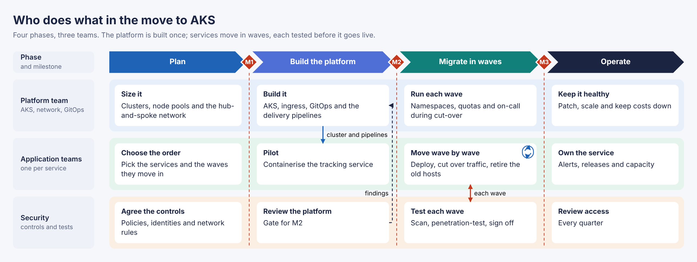

[Brief](samples/page/brief.md) · [source](samples/page/diagram.html) ·
[SVG](samples/page/diagram.svg)

## Repository

| Path | Contains |
|---|---|
| [`skills/graphally/`](skills/graphally) | the skill: `SKILL.md`, `references/`, `scripts/` (the engine), `assets/` (theme, icons) |
| [`.claude-plugin/`](.claude-plugin) | the Claude Code plugin and marketplace manifests |
| [`samples/`](samples) | briefs and the diagrams drawn from them |
| [`docs/design.md`](docs/design.md) | how graphally works, illustrated with diagrams it drew ([sources](docs/diagrams)) |
| [`tools/`](tools) | maintenance scripts, such as rebuilding the icon pack |

## Licence

graphally is licensed under the [graphally Use-Only License](LICENSE). You may install it,
run it and let your agents use its skill for any purpose, including commercial work
inside your organisation, and the diagrams you make are yours. You may not copy,
redistribute, modify, sell, or incorporate graphally or its skill into other products,
services or systems, or use it to train models, without written permission from the
author. For permission or a separate licence, open an issue at
[github.com/kwilcz/graphally](https://github.com/kwilcz/graphally).

Cloud icons are not part of graphally and not covered by this licence. The skill
downloads Microsoft's Azure icons from the draw.io project and the AWS Architecture Icons
from the npm registry; they remain subject to Microsoft's and Amazon's terms.
