# How graphally works

graphally turns a short HTML description of a diagram into a finished SVG. The author,
usually a coding agent, says what exists, what contains what and what talks to what.
graphally decides every coordinate.

## The source

A diagram holds groups, nodes, links and, optionally, an ASCII map of how the main groups
sit relative to each other:

```html
<diagram title="Orders platform">
<layout>
edge  app
.     data
</layout>
<group id=edge label="Edge"><node id=fd icon="front door">Front Door | WAF</node></group>
<group id=app label="Application"><node id=api icon="app service">Orders API</node></group>
<group id=data label="Data"><node id=db icon=sql>Orders DB | Azure SQL</node></group>
<links>
fd -> api : HTTPS
api -> db : writes
</links>
</diagram>
```

There are no coordinates or sizes in it. Adding a node is one line, and the rest of the
diagram makes room for it.

## The pipeline


All of it runs in a headless Chrome, Chromium or Edge, driven by the skill's scripts over
the DevTools protocol, so text is measured with the same font that draws it.

1. **Parse** (`scripts/lib/parse.js`): elements become a model of groups, nodes and links.
   Unknown ids are reported with the nearest existing id.
2. **Measure** (`measure.js`): every label is measured in the browser. Long words break at
   dots and hyphens, and line breaks are balanced.
3. **Lay out**: one algorithm per kind of diagram (below).
4. **Route** (`route.js`): orthogonal edges around the boxes.
5. **Place labels**: edge labels go where they collide with nothing.
6. **Render** (`render.js`): SVG with colours as CSS tokens, icons as reusable symbols, and
   a legend built from what the diagram uses.
7. **Check** (`check.js`): overlapping text, crowded labels, unknown icons, ids missing
   from the layout map, extreme aspect ratios. Each problem is one line that names its fix.

One render, step by step: the script serves the skill and the diagram folder on
127.0.0.1, starts the browser, lets the engine compile the page, and reads back the SVG
and a screenshot.



Most of a render's time is starting the browser and compiling the diagram:


## Layouts

Each kind of diagram uses the layout that suits it:



- **Architecture and networks** (`layout/areas.js`): the ASCII map becomes a CSS grid;
  groups inside it are stacks, rows or grids. Three passes follow the browser's placement:
  - **Shrink:** groups that fill little of their cell shrink to their content.
  - **Align:** nodes slide towards what they connect to, so edges come out straight.
  - **Widen:** gaps between columns widen to hold the labels crossing them.
- **Hierarchies** (`layout/tree.js`): a tidy tree with bus connectors and labelled level
  bands.
- **Processes** (`layout/lanes.js`): columns follow the order of the flow, rows are
  swimlanes, and each node sits on its lane's centre line. Gateways give each branch its
  own corner, and boundary events sit on their task's border.
- **Sequences** (`layout/sequence.js`): lifelines spaced by their cards and labels, and
  activation bars from call to reply. Fragments enclose the messages they contain.
- **Plans** (`layout/gantt.js`): a time axis with day, week or month ticks, one row per
  task, and dependency arrows.

- **Figures in HTML** (`page.js`, `<diagram layout=html>`): the author writes the figure as
  a web page and the browser lays it out, so a grid of phases and roles needs no layout
  algorithm of its own. graphally then reads the page back as SVG: backgrounds, borders,
  `clip-path` polygons, text line by line (each line's words measured in place, with the
  font's ascent for the baseline), icons. A `<script>` runs after layout with the geometry
  of every element (`el('id').right`, `mid(a, b)`) and draws by name; its `connect` calls
  go to the router below, with the page's boxes as obstacles and the script's own straight
  lines counted as taken.

## Routing and labels

Edges are found by A* search over a sparse grid built from the boxes' edges and the
channels between them. A path's cost counts:

- its length;
- its bends;
- crossings, priced above bends;
- running along another edge or along a group's border;
- passing through groups the edge does not belong to.

Routing runs in two passes. The first picks the side each edge leaves from. The second
spreads edges that share a side. A few rounds of rip-up and reroute follow, and then
parallel segments are pulled apart. Edges written in one statement to a shared end bundle
into a trunk.

A link from a whole group to a shared service in a `<band>` is drawn as a badge: the
service's icon in the group's header, instead of a wire across the diagram.

Labels are placed longest first, at candidate positions along their edge. A candidate
must avoid nodes, text, group borders, other labels and other edges' lines.

## Terraform


`scripts/tf2graphally.mjs` reads a Terraform root module and its local modules without
running Terraform. It follows references through variables, locals and module outputs,
and expands `for_each` over literal maps. It then draws what the configuration deploys:

- resource groups as boxes;
- VNets holding subnets, and resources inside the subnet they are deployed into;
- App Service plans holding their apps;
- references as links named by meaning: secrets, telemetry, private link, peering,
  routes.

Associations, role assignments, diagnostic settings and child resources fold into those
links and labels.

## Icons

Azure and AWS icons are not part of the skill. `scripts/fetch-icons.mjs` downloads them
the first time a diagram is rendered, from their upstream sources:

- **Azure:** Microsoft's official icons as published in the draw.io repository, at the
  commit pinned in `assets/icon-sources/azure.txt`.
- **AWS:** the AWS Architecture Icons from the `aws-icons` package on the npm registry.

Each pack becomes one JSON file in `assets/icons/`, or in `~/.cache/graphally/icons` when
the skill folder is read-only. Downloads use `curl` when it is available, so proxy
settings apply, and Node's `fetch` otherwise. Without a network, diagrams still render,
without vendor icons, and the output says how to fetch them.

Icon names are matched loosely, in both packs: `lambda`, `s3`, `app service` and `kv` all
work. `icons=aws` on `<diagram>` makes AWS win names both vendors share, and `aws:` or
`azure:` picks a pack for one icon. A small set of generic outline icons (people,
devices, servers, documents) covers what has no vendor icon.



## Stable layout and overrides

The source is the diagram; the SVG is compiled output, and its elements record where
they landed. Every node is wrapped in `<g data-id data-box="x,y,w,h">`, every group in
`<g data-group data-box>`, and every edge in `<g data-edge data-sides="out,in">`; overrides
add `data-nudge`, `data-out` and `data-in`. Tools can find any element by its id.

When a diagram is rendered again, the CLI reads that layout back from the previous SVG, and
the engine treats it as soft constraints:

- an edge that existed before prefers the sides it used;
- a group whose members did not change keeps its internal arrangement;
- cards keep their width, so a longer new label wraps.

New and changed parts are laid out as usual. `--recompute` ignores the previous SVG.

Overrides are hard constraints, written as attributes in the source: `nudge="dx,dy"` on a
node moves it after layout, and `out` and `in` on a `<link>` fix the sides the edge leaves
and enters. Because they live in the source, an agent's edit keeps them, and a render that
finds one missing compared with the previous SVG reports it. Edges are identified by
key: the link's `id`, else `from->to`, with `#2`, `#3` for repeats.

## Theming and output

Colours are CSS custom properties in `assets/theme.css`, redefined for the dark theme. A
brand theme redefines the tokens and nothing else. A standalone SVG embeds its styles; an
inlined one uses the page's tokens. Text stays text, and the SVG's `aria-label` describes
the diagram in words.
