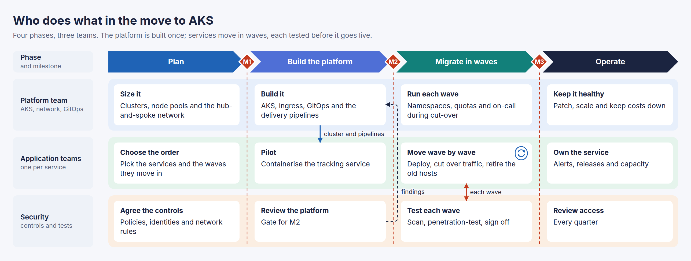
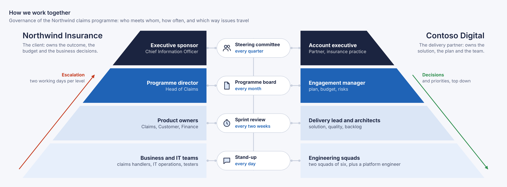
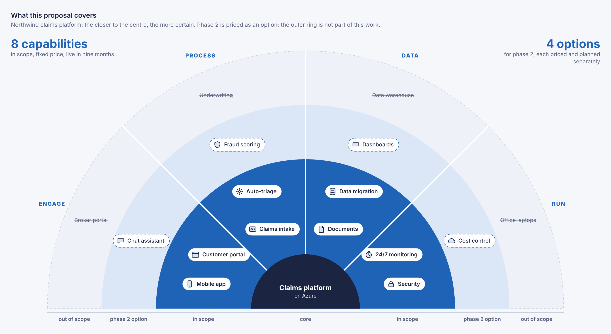
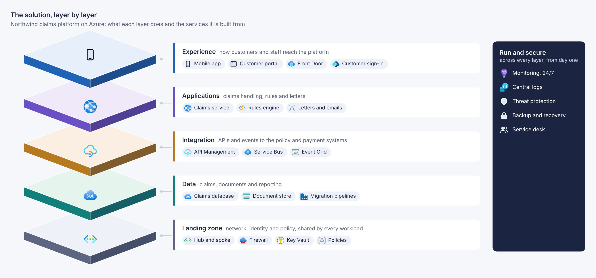

# Showcase

Every figure here was drawn by an agent from a brief. Each folder holds the brief, the
source the agent wrote (`diagram.html`, which also opens in a browser), and the result in
both themes: `diagram.svg` and `diagram-dark.svg`, with PNGs. The pictures on this page
follow your theme.

**Basic** samples are the everyday technical diagrams. Each one follows a recipe from the
skill's references: building blocks in a grid, and a JSON list of connections.

**Advanced** samples go past boxes and lines. They turn dates into grid columns, cut
shapes in CSS, place items by angle, or draw geometry around the layout. Most were made
for proposals, statements of work and solution designs.

**Designed for the point** samples began as briefs that name no kind of diagram. The agent
wrote down the point and who reads it, weighed three visual metaphors, kept one, and chose
what each visual variable carries; that design is a comment at the top of each source. The
technical ones are drawn in depth, from the brief an engineer would write.

| Basic | | Advanced | |
|---|---|---|---|
| [Architecture](#architecture) | Azure field-service platform | [Plan (Gantt)](#plan-gantt) | six-month migration plan |
| [AWS](#aws) | serverless photo sharing | [Phase and role chart](#phase-and-role-chart) | who does what in a move to AKS |
| [Network](#network) | hub, spokes, private endpoints | [Governance pyramid](#governance-pyramid) | who meets whom, and how often |
| [Terraform repository](#terraform-repository) | drafted from the code | [Scope target](#scope-target) | in scope, options, out of scope |
| [Process (BPMN)](#process-bpmn) | expense approval in four lanes | [Solution stack](#solution-stack) | the platform as layers |
| [Flowchart](#flowchart) | release pipeline with rollback | | |
| [Sequence](#sequence) | checkout with 3-D Secure | | |
| [Hierarchy](#hierarchy) | management groups | | |
| [Icon diagram](#icon-diagram) | Entra application proxy | | |

| Designed for the point | | Technical, in depth | |
|---|---|---|---|
| [Why the cloud bill grew](#why-the-cloud-bill-grew) | the rise, magnified to scale | [Order platform on Azure](#order-platform-on-azure) | hub and spoke, private endpoints |
| [Where customer data comes from](#where-customer-data-comes-from) | records tidied stage by stage | [Telemetry ingestion on AWS](#telemetry-ingestion-on-aws) | validated once, split three ways |
| [The same brief, another design](#the-same-brief-another-design) | a lake that clears | [Landing zone network](#landing-zone-network) | all egress through the firewall |
| [Three waves to Azure](#three-waves-to-azure) | width for months, height for risk | [Insurance claim process](#insurance-claim-process) | BPMN, four ways a claim ends |
| [How a change reaches production](#how-a-change-reaches-production) | waits to scale, users as dots | | |
| [Who is responsible for what](#who-is-responsible-for-what) | two territories that overlap | | |
| [The orders diagram, for business](#the-orders-diagram-for-business) | a wall where the order is saved | | |

## Basic

### Architecture

<picture><source media="(prefers-color-scheme: dark)" srcset="architecture/diagram-dark.png"></picture>

Tiers as columns, a platform band, async traffic dashed, external systems dashed. Shared
services (Key Vault, App Insights, the registry) appear as badges in the headers of the
tiers that use them, instead of wires.
[Brief](architecture/brief.md) · [source](architecture/diagram.html) · [SVG](architecture/diagram.svg)

### AWS

<picture><source media="(prefers-color-scheme: dark)" srcset="aws/diagram-dark.png"></picture>

The same kind of diagram with the AWS pack: CloudFront and WAF at the edge, Lambda
functions behind API Gateway, and the asynchronous path from S3 through SQS and SNS
drawn dashed. CloudWatch and Secrets Manager are badges on the two function groups.
[Brief](aws/brief.md) · [source](aws/diagram.html) · [SVG](aws/diagram.svg)

### Network

<picture><source media="(prefers-color-scheme: dark)" srcset="network/diagram-dark.png"></picture>

VNets, subnets with their address ranges, resources inside their subnets, peering, a
default route to the firewall, private endpoints to the PaaS services below.
[Brief](network/brief.md) · [source](network/diagram.html) · [SVG](network/diagram.svg)

### Terraform repository

<picture><source media="(prefers-color-scheme: dark)" srcset="terraform/diagram-dark.png"></picture>

`tf2graphally` read the configuration in [`repo/`](terraform/repo) and wrote
[`draft.html`](terraform/draft.html) ([rendered](terraform/draft.svg)), without the agent
reading the HCL. The agent then added what Terraform cannot know, the users and the VPN
from head office, and rearranged the services.
[Brief](terraform/brief.md) · [source](terraform/diagram.html) · [SVG](terraform/diagram.svg)

### Process (BPMN)

<picture><source media="(prefers-color-scheme: dark)" srcset="process/diagram-dark.png"></picture>

Four lanes, one column per step in the order the flow runs, gateways with labelled
branches, a three-day timer on the review task, notices between lanes dashed.
[Brief](process/brief.md) · [source](process/diagram.html) · [SVG](process/diagram.svg)

### Flowchart

<picture><source media="(prefers-color-scheme: dark)" srcset="flowchart/diagram-dark.png"></picture>

The happy path runs along the middle; every failure branches up, and the expired
approval drops below.
[Brief](flowchart/brief.md) · [source](flowchart/diagram.html) · [SVG](flowchart/diagram.svg)

### Sequence

<picture><source media="(prefers-color-scheme: dark)" srcset="sequence/diagram-dark.png"></picture>

Numbered steps, activation bars, an `alt` for 3-D Secure, a `par` with a polling `loop`.
[Brief](sequence/brief.md) · [source](sequence/diagram.html) · [SVG](sequence/diagram.svg)

### Hierarchy

<picture><source media="(prefers-color-scheme: dark)" srcset="hierarchy/diagram-dark.png"></picture>

One column per leaf and one row per level: each parent spans its children, and one
connection per parent draws its bus.
[Brief](hierarchy/brief.md) · [source](hierarchy/diagram.html) · [SVG](hierarchy/diagram.svg)

### Icon diagram

<picture><source media="(prefers-color-scheme: dark)" srcset="icons/diagram-dark.png"></picture>

Figures: an icon over its name, in plain groups.
[Brief](icons/brief.md) · [source](icons/diagram.html) · [SVG](icons/diagram.svg)

## Advanced

### Plan (Gantt)

<picture><source media="(prefers-color-scheme: dark)" srcset="plan/diagram-dark.png"></picture>

A task table beside the chart, a critical path, a blocked approval holding back the
pilot, parallel work, and only the dependencies that tell the story.
**Technique:** `schedule()` and `timeline()` turn dates into grid columns, so each bar's
left edge is its start date; `depend()` draws each dependency clear of the bars
([`plan.md`](../skills/graphally/references/plan.md)).
[Brief](plan/brief.md) · [source](plan/diagram.html) · [SVG](plan/diagram.svg)

### Phase and role chart

<picture><source media="(prefers-color-scheme: dark)" srcset="phases/diagram-dark.png"></picture>

Four phases as chevrons, three teams as bands of cards, milestones on the boundaries
between phases, hand-offs between the teams, and a repeat badge on the wave that loops.
**Technique:** the bands line up with the phases through `subgrid`; the script finds each
boundary between two elements and puts a milestone on it
([`charts.md`](../skills/graphally/references/charts.md)).
[Brief](phases/brief.md) · [source](phases/diagram.html) · [SVG](phases/diagram.svg)

### Governance pyramid

<picture><source media="(prefers-color-scheme: dark)" srcset="governance/diagram-dark.png"></picture>

The client's levels on the left, the partner's on the right, and on the spine between
them the forum where each level meets its counterpart, with how often it meets.
Escalations climb one slope; decisions come down the other.
**Technique:** each tier is a box in a grid cell, cut by `clip-path: polygon()` so its
slope continues the tier above; only the arrows come from the script
([`documents.md`](../skills/graphally/references/documents.md)).
[Brief](governance/brief.md) · [source](governance/diagram.html) · [SVG](governance/diagram.svg)

### Scope target

<picture><source media="(prefers-color-scheme: dark)" srcset="scope/diagram-dark.png"></picture>

Certainty as rings: in scope at the centre, phase-2 options around it, out of scope
struck through on the outside. Four areas split by spokes, a ruler naming the rings, and
the headline numbers in the corners.
**Technique:** the rings are `semicircle` shapes stacked in one corner; a five-line
before-script places each item by its angle and distance from the centre
([`documents.md`](../skills/graphally/references/documents.md)).
[Brief](scope/brief.md) · [source](scope/diagram.html) · [SVG](scope/diagram.svg)

### Solution stack

<picture><source media="(prefers-color-scheme: dark)" srcset="stack/diagram-dark.png"></picture>

The platform as five layers, from the landing zone up to what customers use, each with
the services it is built from, and the work that runs across every layer beside them.
**Technique:** the grid puts an empty cell beside each layer's card; the script draws an
isometric slab around each cell, bottom first, in shades mixed from the theme tokens
([`documents.md`](../skills/graphally/references/documents.md)).
[Brief](stack/brief.md) · [source](stack/diagram.html) · [SVG](stack/diagram.svg)

## Designed for the point

### Why the cloud bill grew

<picture><source media="(prefers-color-scheme: dark)" srcset="cost-rise/diagram-dark.png"></picture>

The whole 84k bill as one bar, to scale. The 24k rise fans out into three cards that keep
its proportions, so compute's share shows before a number is read. Hue says what drives
each cost (blue follows customers, warm follows what we keep); the idle test environment
is dashed.
**Technique:** the fan is three `clip-path: polygon()` ribbons between the bar and the
cards; the brackets come from the drawing script.
[Brief](cost-rise/brief.md) · [source](cost-rise/diagram.html) · [SVG](cost-rise/diagram.svg)

### Where customer data comes from

<picture><source media="(prefers-color-scheme: dark)" srcset="data-lineage/diagram-dark.png"></picture>

Four systems, three cleaning stages, two uses, and inside each stage the same records as
dots coloured by their system: scattered, with duplicates, in raw; sorted in cleaned;
joined into one row per customer in business-ready.
**Technique:** a seeded generator places the dots with `shape('circle', …)` in the drawing
script, so a re-render leaves them where they were; the flows are a JSON list.
[Brief](data-lineage/brief.md) · [source](data-lineage/diagram.html) · [SVG](data-lineage/diagram.svg)

### The same brief, another design

<picture><source media="(prefers-color-scheme: dark)" srcset="data-lake/diagram-dark.png"></picture>

The brief above, designed again: the lakehouse as water that clears from murky to blue,
the silt thinning from zone to zone, the dashboards marketing uses at the clear end. One
agent wrote the design down; another built the figure from that note alone.
**Technique:** three `clip-path` zones share their seam heights to make one body of water;
the specks come from a seeded drawing script that keeps them out of the text.
[Brief](data-lake/brief.md) · [source](data-lake/diagram.html) · [SVG](data-lake/diagram.svg)

### Three waves to Azure

<picture><source media="(prefers-color-scheme: dark)" srcset="migration-waves/diagram-dark.png"></picture>

Each wave is as wide as its months and as tall as its risk, with one square per
application, so 70, 40 and 10 compare at a glance. The mainframe runs above all three
waves and is switched off at month 18; the landing zone built in wave 1 carries the rest.
**Technique:** a before-script makes one square per application from a `data-n` count;
the waves span columns of an 18-month grid.
[Brief](migration-waves/brief.md) · [source](migration-waves/diagram.html) · [SVG](migration-waves/diagram.svg)

### How a change reaches production

<picture><source media="(prefers-color-scheme: dark)" srcset="release-gates/diagram-dark.png"></picture>

Four checkpoints on one road. Each wait is drawn to scale under its step, and twenty dots
per step show the share of users who have the change: none, none, none, one, all. A
single red rail carries every failure back to the developer.
**Technique:** a before-script fills each meter of dots; the road is a `clip-path` arrow;
the rail and its drops come from the drawing script.
[Brief](release-gates/brief.md) · [source](release-gates/diagram.html) · [SVG](release-gates/diagram.svg)

### Who is responsible for what

<picture><source media="(prefers-color-scheme: dark)" srcset="responsibility-split/diagram-dark.png"></picture>

Two territories that overlap. The shared duties sit in the overlap, each card half
provider blue and half client amber, and the weekly board is a round table with a seat
for each side.
**Technique:** the zones span overlapping grid columns; each shared card is two halves,
one cut by `clip-path`; the two-tone rim is two `draw.arc` calls.
[Brief](responsibility-split/brief.md) · [source](responsibility-split/diagram.html) · [SVG](responsibility-split/diagram.svg)

### The orders diagram, for business

<picture><source media="(prefers-color-scheme: dark)" srcset="order-journey/diagram-dark.png"></picture>

An engineer's topology of six systems, redrawn for business readers: four steps while
the customer waits, a wall with an "Order saved" seal, then two steps in the background,
numbered and in plain words, with the Azure names in small type.
**Technique:** two zones in one grid row; the wall and the tick come from the drawing
script; the connections are data.
[Brief](order-journey/brief.md) · [source](order-journey/diagram.html) · [SVG](order-journey/diagram.svg)

### Technical, in depth

The same skill on the everyday technical diagrams, from briefs an engineer would write.

#### Order platform on Azure

<picture><source media="(prefers-color-scheme: dark)" srcset="azure-platform/diagram-dark.png"></picture>

Hub and spoke with every subnet named: AKS behind an internal Application Gateway,
private endpoints to SQL and Cosmos DB, Functions in their own subnet sending the SAP sync
through the hub firewall (the teal path). Shared services appear once, as a band and as
badges on the groups that use them.
**Technique:** `vnet` and `subnet` groups of borderless `figure`s, badges in the group
titles, connections as data ([`network.md`](../skills/graphally/references/network.md)).
[Brief](azure-platform/brief.md) · [source](azure-platform/diagram.html) · [SVG](azure-platform/diagram.svg)

#### Telemetry ingestion on AWS

<picture><source media="(prefers-color-scheme: dark)" srcset="aws-telemetry/diagram-dark.png"></picture>

Validated once, then split three ways: live dashboards, the data lake and the failure
path, each in a tinted lane. The two availability zones are drawn around the one
component that runs in each; a note says why the regional services are not.
**Technique:** `icons=aws`, lanes as tinted groups in a grid, and a bundle of connections
fanning out of the validation step.
[Brief](aws-telemetry/brief.md) · [source](aws-telemetry/diagram.html) · [SVG](aws-telemetry/diagram.svg)

#### Landing zone network

<picture><source media="(prefers-color-scheme: dark)" srcset="landing-zone/diagram-dark.png"></picture>

The firewall at the centre of a cross: the Warsaw office and its VPN on one side, the
private DNS zones on the other, the spokes below with peering up their outer sides and
the default route up their inner sides. Egress is the only blue line.
**Technique:** `vnet` and `subnet` groups carry their address ranges; peering and the
routes are straight lines from the drawing script.
[Brief](landing-zone/brief.md) · [source](landing-zone/diagram.html) · [SVG](landing-zone/diagram.svg)

#### Insurance claim process

<picture><source media="(prefers-color-scheme: dark)" srcset="claims-process/diagram-dark.png"></picture>

Seven lanes, a 14-day timer on the customer's task, the 10,000 EUR gateway before the
team lead, and the four ways a claim ends, which are the only coloured marks.
**Technique:** BPMN `shape=` events, tasks and gateways in a grid of lanes, connections as
data ([`process.md`](../skills/graphally/references/process.md)).
[Brief](claims-process/brief.md) · [source](claims-process/diagram.html) · [SVG](claims-process/diagram.svg)
