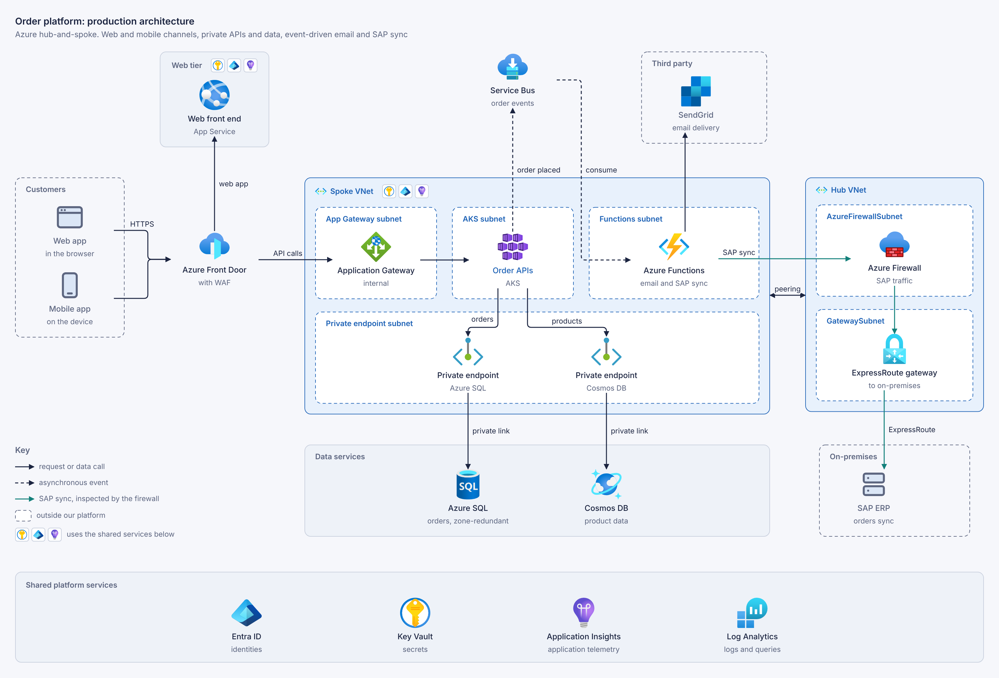

# graphally

**AI-generated technical diagrams, rendered to SVG.** This package is the engine; the same
folder is an agent skill. A diagram is a small web page: HTML holds the components and their
nesting, CSS sets the layout, and a JSON list declares the connections. graphally lays the
page out in a browser, routes the connections around the boxes and writes an SVG
(and a PNG if you ask). Nobody writes a coordinate.



It draws architecture with Azure and AWS icons, networks, hierarchies, BPMN processes,
sequence diagrams, Gantt plans and roadmaps, and any figure a web page can hold. Agents
write the source; this package renders it, for tools, pipelines and CI.

## Requirements

Node.js 18 or later, and Chrome, Chromium or Edge on the machine (or
`npx playwright install chromium`). There are no dependencies to install. The first render
that names a cloud icon downloads the Azure and AWS icon packs, once.

## Command

```html
<!-- diagram.html -->
<diagram width=420>
  <div class="flex gap-24">
    <div class=card id=web>Web app</div>
    <div class=card id=api>API</div>
    <div class=card id=db>Database</div>
  </div>
  <script type="application/json">[["web", "api"], ["api", "db"]]</script>
</diagram>
```

```sh
npx graphally render diagram.html --png
```

This writes `diagram.svg` and a half-size preview, `diagram.png`, next to the source.
`--png1x` writes the PNG at full size and `--png2x` at twice the size, sharp enough to
publish. `--themes` adds the dark variants, `--out <dir>` writes elsewhere, and `--json` prints the result as data. The render
also adds a three-line header to the source, so the `.html` file draws itself when opened in
a browser.

## Node API

```js
import { render } from 'graphally';

const { exitCode, files } = await render(['diagram.html'], { png: true });
```

The options are the command's flags. Each file in the result lists its diagrams: the files
written, their size, the layout problems found, and statistics.

| Export | Contains |
|---|---|
| `graphally` | `render()`, the API above |
| `graphally/engine` | the engine itself: `compile()` turns a laid-out `<diagram>` into SVG in a browser page |
| `graphally/edits` | source edits as text patches: move and nudge elements, add or remove connections |
| `graphally/viewer` | the viewer script that makes a diagram file draw itself |
| `graphally/theme.css` | the theme's CSS tokens |

## More

The format, the samples and the agent skill (Claude Code, GitHub Copilot and other agents):
[github.com/kwilcz/graphally](https://github.com/kwilcz/graphally). Licensed under the
Apache License 2.0.
